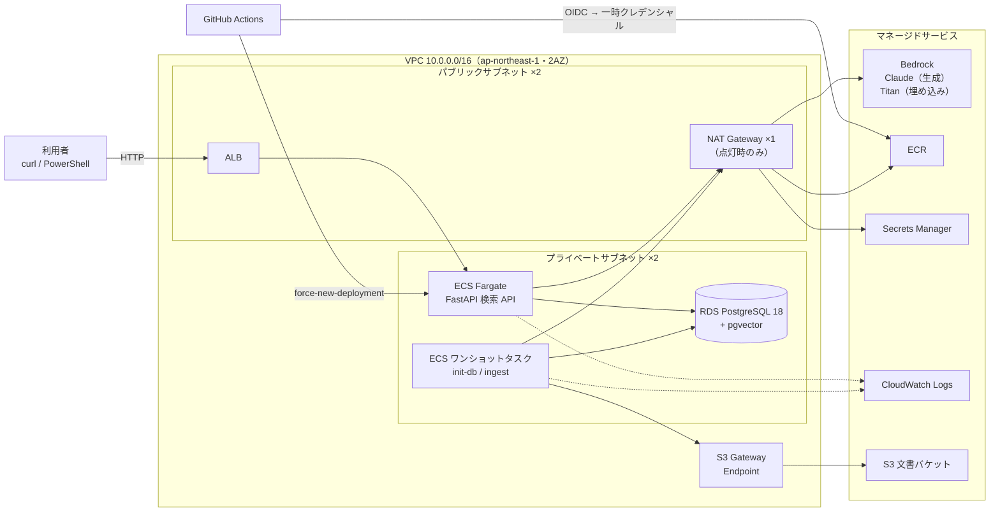

# aws-rag-knowledge-search

社内文書を根拠に回答する **ナレッジ検索 RAG（Retrieval-Augmented Generation）** を、AWS 上に本番相当の構成で構築した個人プロジェクトです。

- 回答生成：Amazon Bedrock（Claude Sonnet 4.6、**日本国内 inference profile `jp.`**）
- ベクトル化：Amazon Titan Text Embeddings V2（1024 次元）
- ベクトル検索：RDS for PostgreSQL 18 + pgvector
- 実行基盤：ECS Fargate（プライベートサブネット）+ ALB
- IaC：Terraform（5 モジュール、S3 backend + ロック）
- CI/CD：GitHub Actions（**OIDC**、長期アクセスキーなし）

> 重視したのは「何を使ったか」より「なぜこの構成にしたか」です。各判断の理由と、実際に測った数字を下に残しています。

---

## アーキテクチャ



- アプリも DB もプライベートサブネットに置き、インターネットからの入口は ALB だけです。
- RDS は `Public access = No` です。セキュリティグループは `alb-sg → app-sg → rds-sg` の参照チェーンで、IP ではなく SG 単位で許可しています。
- 外向き通信（Bedrock / ECR / Secrets Manager）は NAT Gateway 1 台に集約しています。理由は「コスト設計」を参照してください。
- `frontend/` は S3 + CloudFront の配信確認用の静的ページで、API は呼び出しません（Terraform 管理外）。

### データフロー

**① 文書取込（非同期・ワンショット）**

S3 `docs/` の txt / md / pdf → 文単位で分割し 500 字 / 重なり 80 字でチャンク化 → Titan で 1024 次元にベクトル化 → pgvector に INSERT（同一文書の再取込は冪等）

**② 検索・回答（同期）**

質問 → ALB → FastAPI → 質問を Titan でベクトル化 → pgvector の余弦距離で Top-5 → 最上位の類似度が閾値未満なら **Claude を呼ばずに「該当なし」** → 閾値以上なら番号付きの参考資料として Claude に渡し、**出典付きで回答**

```powershell
.\scripts\ask.ps1 -Question "テレワークの申請手順は？"           # RAG あり
.\scripts\ask.ps1 -Question "テレワークの申請手順は？" -NoRag    # 比較用：検索なしの素の生成
```

レスポンスは `answer` に加えて、`sources[]`（文書名・チャンク番号・類似度・抜粋）と `rag.top_similarity` を返します。ベクトル検索の取りこぼしはエラーにならず「静かに」起きるため、**類似度を必ず外に出す**設計にしています。

---

## 技術選定の理由

| 選択 | 理由 | 採らなかった選択肢 |
|---|---|---|
| ECS Fargate | サーバー管理が不要で、小規模運用の負荷が最小 | EKS：この規模では Kubernetes の運用コストが見合わない |
| RDS PostgreSQL + pgvector | RDB とベクトル検索を 1 つに集約でき、運用とコストが単純 | OpenSearch：大規模・高 QPS になった段階で移行を検討 |
| Bedrock（`jp.` inference profile） | AWS 内で完結し IAM で権限管理できる。**推論が日本国内で完結**し、社内文書が国外に出ない | 外部 LLM API の直接利用 |
| Claude Sonnet（Opus ではない） | RAG の回答生成には十分な品質で、コストを抑えられる | Opus：精度要件が厳しい用途なら切替可能 |
| 取込を ECS ワンショットタスクで | RDS はプライベートで、VPC 外の Lambda からは届かない。API と同じイメージ・ネットワーク・IAM を再利用できる最小構成 | Lambda：VPC アタッチと外向き経路が別途必要 |
| Terraform | 手作業で構築した環境をコード化し、再現性と差分レビューを得る | CloudFormation / CDK も概念は同じ |
| GitHub Actions + OIDC | CI に長期認証情報を置かない | アクセスキーを GitHub Secrets に保存する方式 |

---

## RAG の設計判断

| 項目 | 採用値 | 理由 |
|---|---|---|
| チャンクサイズ | 500 字（文境界を尊重） | 大きいと 1 チャンクに話題が混ざって検索精度が落ち、小さいと文脈が足りない |
| オーバーラップ | 80 字 | 機械的に切ると文や概念が分断される |
| 次元数 | 1024（Titan V2 既定） | 低次元は省スペースだが精度が落ちる |
| 距離 | 余弦距離 `<=>` | Titan V2 は正規化済みのため余弦と内積は等価。明示的に余弦を選んだ |
| インデックス | **あえて張らない** | 数千件規模では逐次スキャンの方が速く、HNSW / IVFFlat は近似のため精度も落ちる。件数が増えた時点で張る |
| Top-K | 5 | 3 / 5 / 10 を実測比較して決定（下表） |
| 類似度閾値 | 0.25 | 閾値未満は生成しない。トークン課金がゼロになり、幻覚の入口も塞げる |

**ハルシネーション対策は 3 層**で、それぞれ単独で効くことを確認しています。

1. 出典番号 `[n]` を必須にする
2. システムプロンプトで「資料にないことは答えない」と制約する
3. 最上位の類似度が閾値未満なら、そもそも Claude を呼ばない

### 実測（サンプル文書 4 件・16 チャンク、10 問）

| 観点 | 結果 |
|---|---|
| 文書内の質問の最上位類似度 | 0.653 / 0.624 など |
| 文書外の質問の最上位類似度 | 0.045（閾値で遮断、生成なし） |
| Top-K 3 / 5 / 10 の入力トークン | 1,614 / 2,562 / 5,026（回答内容は同一）→ K=5 を採用 |
| 期待どおりの結果 | 10 問中 9 問 |

外れた 1 問は**偽陰性**です。「在宅勤務手当」を尋ねた質問の類似度が 0.225 で、閾値に届きませんでした。文書側の表記は「テレワーク」と漢数字の金額で、語彙が一致しなかったことが原因です。閾値を下げると無関係な文脈も通るため、閾値は据え置きました。改善はハイブリッド検索（`tsvector` によるキーワード検索との併用）で行う方針です。

---

## セキュリティ設計

- **長期の秘密情報をどこにも置かない**
  - DB パスワード：Terraform の `random_password` から RDS と Secrets Manager へ直接渡し、人もコードも平文を扱いません。アプリは ECS の `secrets`（`valueFrom`）で受け取ります。
  - CI：GitHub Actions は OIDC で一時クレデンシャルを取得します。アクセスキーは存在しません。
- **IAM ロールを役割で分離し、最小権限にする**

  | ロール | 使う主体 | 許可 |
  |---|---|---|
  | Task Execution Role | ECS 基盤（コンテナを起動する側） | ECR pull、Logs 書込、この 1 シークレットの取得 |
  | Task Role | コンテナ内のアプリ | 使う 2 モデルの ARN に限定した Bedrock 呼出、`docs/*` に限定した S3 読取 |
  | GitHub deploy Role | CI | `rag-tf-api` への ECR push、`rag-tf-api-service` の UpdateService のみ |

- **deploy ロールの信頼ポリシー**は `sub = repo:<owner>/<repo>:ref:refs/heads/main` を `StringEquals` で完全一致にしています。`StringLike` とワイルドカードにすると、別ブランチや PR からもロールを引き受けられてしまうためです。
- CI のロールには `RegisterTaskDefinition` と `iam:PassRole` を与えていません。タスク定義は Terraform の管理下に残し、CI はイメージ更新と再デプロイだけを担当します。
- コンテナは非 root ユーザーで実行します。
- CORS は既定で全拒否です。ブラウザのフロントから呼ぶ場合だけ、`allowed_origins` にそのドメインを設定します。
- 公開用のファイルは許可リスト方式で書き出し、公開前にアクセスキー・秘密鍵・アカウント ID・state ファイルを機械的に走査しています。

---

## コスト設計

個人の検証環境なので、「使わない時間はお金がかからない」ことを構成で担保しています。

| 項目 | 判断 |
|---|---|
| NAT Gateway | 最大の固定費（約 $45/月）。`enable_nat` で NAT・EIP・デフォルトルートを同時に増減し、使わない日は消す |
| NAT か VPC エンドポイントか | Interface Endpoint は ECR API / ECR DKR / Logs / Secrets Manager / Bedrock の 5 つが必要で、この規模では NAT 1 台より高くなる。閉域要件があれば切り替える |
| S3 Gateway Endpoint | 無料。ECR のイメージレイヤー取得が NAT のデータ処理料金を通らなくなる |
| Fargate | 0.25 vCPU / 0.5 GB。消灯時は `desired_count = 0` |
| RDS | db.t4g.micro・単一 AZ。停止しても 7 日で自動起動する仕様に注意 |
| ECR / Logs | ライフサイクルで直近 10 イメージ、ログ保持 14 日 |

`terraform/lights.ps1` で点灯・消灯をまとめて切り替えます。

```powershell
.\terraform\lights.ps1 on      # RDS 起動 + NAT 作成 + タスク 1
.\terraform\lights.ps1 off     # NAT 削除 + タスク 0 + RDS 停止
.\terraform\lights.ps1 status
```

---

## CI/CD

`.github/workflows/deploy.yml` は、`main` への push のうち `app/` かワークフロー自身が変わった時に動きます。

1. **test**：構文チェックと `/health` のスモークテスト。AWS 認証なしで実行し、失敗したらイメージを作りません。
2. **deploy**：OIDC で deploy ロールを引き受け → イメージを build → ECR に `:<commit SHA>` と `:latest` で push → `update-service --force-new-deployment` → `services-stable` まで待機。

公開リポジトリの Actions ログは誰でも読めます。そのためロール ARN はリポジトリの Secret に置き、アカウント ID はログ上でマスクしています。

---

## ディレクトリ構成

```
app/            FastAPI（main.py / rag.py / embeddings.py / ingest.py / init_db.py / db.py）と Dockerfile
terraform/      IaC 本体。bootstrap/（state バケット）と modules/{network,db,storage,app,cicd}
sample_docs/    架空の社内文書 4 件（取込・検索の検証用）
scripts/ask.ps1 PowerShell 5.1 から /api/ask を呼ぶテストスクリプト
frontend/       CloudFront 配信確認用の静的ページ
.github/        GitHub Actions ワークフロー
```

## セットアップ

手順の詳細と設計判断は [terraform/README.md](terraform/README.md) にあります。概要は次のとおりです。

```powershell
cd terraform\bootstrap; terraform init; terraform apply; cd ..   # 初回のみ：state バケット
copy example.tfvars terraform.tfvars
terraform init
terraform apply                                                  # 既定は消灯状態で構築
terraform output -raw cmd_push_image                             # 初回イメージの push 手順
.\lights.ps1 on
.\run_job.ps1 -Job init-db                                       # pgvector 有効化と DDL
.\run_job.ps1 -Job ingest                                        # 文書取込
..\scripts\ask.ps1 -Question "テレワークの申請手順は？"
.\lights.ps1 off
```

---

## トラブルシュート記録

コード中のコメントにある「トラブルシュート記録 #N」の対応表です。詰まったのは主にコードではなく、AWS の仕様と実行環境の境界でした。

| # | 現象 | 原因と対処 |
|---|---|---|
| 2 | Bedrock で Claude を呼ぶと `on-demand throughput isn't supported` | 新しい Claude は inference profile 経由が必須。`list_inference_profiles` で実在する ID を調べ、国内完結の `jp.` を選択 |
| 3 | ECS から ECR のイメージが見つからない | リポジトリを大阪リージョンに作っていた。ECR はリージョン単位のため東京で作り直し |
| 6 | NAT はパブリックに置くのに、ルートはプライベート側に書く理由が腑に落ちない | NAT 自身が IGW 経由で外に出るためパブリックに置き、使う側のプライベートサブネットのルートで NAT を指す |
| 11 | PowerShell 5.1 から curl で JSON を送ると 422 | PS 5.1 がネイティブコマンドへの引数から `\"` を落とす。UTF-8 バイト列の body で `Invoke-RestMethod` を使う（`ask.ps1`） |
| 12 | 回答の日本語が文字化けする | `charset` 指定のない JSON を PS 5.1 が Latin-1 で解釈していた。API 側で `charset=utf-8` を明示 |
| 13 | 新しいイメージを push しても古いコードが動き続ける | コンソールで作ったタスク定義の image がダイジェスト固定になっていた。タグは可変、ダイジェストは不変 |
| 14 | 取込タスクだけ Titan 呼出で AccessDenied | Task Role に Claude の ARN しか許可していなかった。ローカルでは自分の IAM ユーザーで動いていたため気付かなかった |
| 15 | 文書にある答えが「該当なし」になる | 語彙の不一致による偽陰性（「RAG の設計判断」を参照） |
| 18 | `get-login-password` を `docker login --password-stdin` にパイプすると 400 | PS 5.1 のパイプが末尾に CR を付ける。サブ式で `--password` に渡す |

## 既知の課題と次の改善

- ハイブリッド検索（キーワード + ベクトル）による偽陰性の解消
- HTTPS（独自ドメイン + ACM）と WAF
- Interface Endpoint 化による NAT 依存の削減
- RDS の Multi-AZ・削除保護・最終スナップショット（本番値は `variables.tf` のコメント参照）
- ECR を IMMUTABLE にし、CI がダイジェスト固定のタスク定義を発行する方式への移行
- フロントエンド（S3 + CloudFront）のコード化、staging / production の分離
- 自動テストの拡充（現状は構文チェックとスモークテストのみ）

## 開発体制

要件の整理、アーキテクチャと RAG の設計判断、AWS 上での構築作業、トラブルシュートは自分で行いました。構築作業には、コンソールでの手作業構築と、その Terraform 化の apply・検証を含みます。アプリケーションと Terraform のコードは生成 AI（Claude）を活用して作成し、内容を読んで動作を検証しながら進めています。
